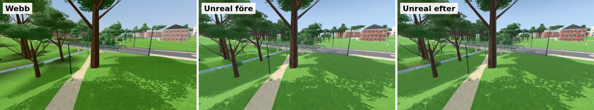
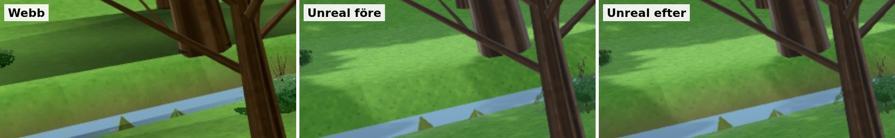
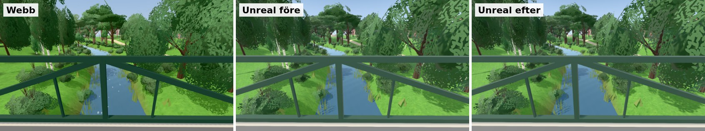
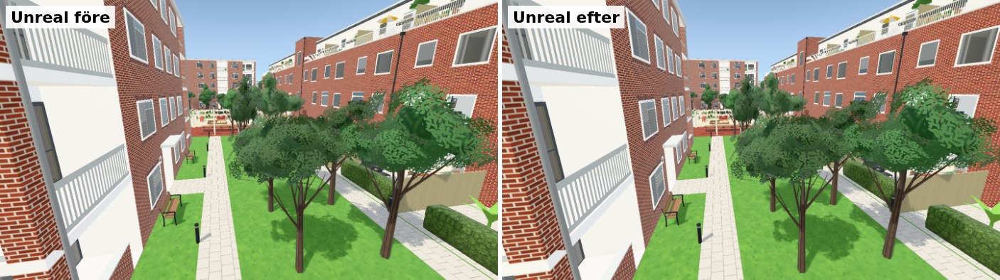

# The olive band on Höje å's far slope in Unreal (#2441)

Unreal Editor 5.8.4 on Windows 11, 2026-11-22, headless (`-RenderOffScreen`, `-nullrhi` for the builders). Warm Windows
checkout `lunden-ue-wt/opus-release-2419` at main `c824555a` with this change applied; world export from WSL at the same
revision with the change (only `omgivning.glb` differs from the checkout's previous import, every other GLB is
byte-identical), `sync-import.ps1 -Zones omgivning`, `build_materials.py`. Web halves: #2390's committed captures (no
grass, terrain or river source changed since). Unreal: `tests/capture_vegetation.py` with #2390's cameras, 21 June
14:00, clear, the game's exposure ([`unreal-capture.json`](unreal-capture.json)); "before" is the same checkout and
cameras just before the change.

## Cause

The band is the river bed's mud. The site terrain uses `src/grass.js grassMaterial`'s bed variant: `src/surroundings.js
bedMud` gives every terrain vertex below Höje å's water line a share of `MUSSELS.bed`'s mud tone (0x74664b), and the
coarse terrain triangles interpolate that share from the submerged vertices up to the bank top, so the slope closest to
the water reads olive on the web. The export dropped the `bedMud` attribute and `M_LundenGrass` had no mud step, so
Unreal drew plain lawn there.

## Change

- Export: `splitMesh` interpolates `bedMud` across the zone cuts and `export-river.js riverBedGeometry` writes it as
  COLOR_0 = (1 − bedMud, 1, 1) on the terrain pieces that hold any mud (`site-terrain-remainder` and `-southeast` in
  `omgivning`). Interchange stores COLOR_0 so that the shader reads the glTF value (`GLTFMeshFactory.cpp` undoes the
  engine's sRGB step), 8 bits like the web's byte.
- `M_LundenGrass`: `BedColor` × the web's `bedTone` patches replaces the lawn by `BedWeight` × (1 − vertex colour red), and
  the fallen leaves stay off the mud (the web's `leafLitter` mask). `MI_LundenGrassLawn`: `BedColor` #74664b, `BedWeight` 1.
  Lawns without COLOR_0 read Unreal's white default and are unchanged.
- `M_LundenGltfUnlitVertexColor` rebuilt as well: #2435 edited its `material-map.json` note, which is part of the spec
  hash, so `build_materials.py` stopped at it; the graph is unchanged.

## Pictures

| | |
|---|---|
|  |  |
|  |  |

## Crops

Crops that hold only the slope between the water and the shade ([`crops.json`](crops.json)), measured with #2410's
[`masked-crop-stats.cjs`](../2410/masked-crop-stats.cjs) (mean sRGB, Unreal ÷ web; full output
[`crop-stats.txt`](crop-stats.txt)):

| Crop | Web | Before | After | After, per channel |
|---|---|---|---|---|
| slope band 1 | 98, 129, 52 | 94, 152, 61 | 104, 136, 66 | +6, +6, +28 % |
| slope band 2 | 95, 128, 50 | 84, 142, 55 | 94, 129, 60 | −1, 0, +19 % |
| slope band 3 | 100, 130, 53 | 94, 152, 61 | 105, 135, 66 | +5, +4, +26 % |
| lawn in the sun (reference) | 128, 177, 84 | 144, 191, 112 | 144, 191, 112 | +12, +8, +33 % |
| lawn in shade (reference) | 64, 118, 32 | 71, 126, 48 | 71, 126, 48 | +12, +7, +49 % |

Red and green on the slope are now within ±6 % of the web (before: green +11 … +18 %). Blue is +19 … +28 %: every
surface in the frame has that excess, the plain lawns more (+33 … +49 %), because Unreal reflects its sky in every
surface and the web reflects none (#2410's lawn test without the reflection brought them within ±10 %). That is the
open #2424 in the light chain, not the slope's colour. The lawn crops elsewhere in the frame are unchanged.

## Tree shadows on the slope (intended deviation)

The web's sun shadow map covers only ±14 m round a box that follows the visitor (`src/main.js`, `SHADOW_BOX`). Beyond it
`src/groundao.js` draws solid baked discs under the crowns, and the box's rim leaves a straight edge where the real
shadows stop. That web-only infrastructure is G22 (not applicable); Unreal's shadows reach every distance, so the slope
shows the crowns' own dappled shadows instead. Documented in `docs/development/unreal.md` (#2426's shadow paragraph).
The Unreal shade is also lighter than the web's: sky fill and reflection, #2424.

## Checks

- `node tools/unreal-engine/check-export.mjs --dir <export>`: current, 11 files, 9,385 nodes.
- `node tools/unreal-engine/tests/grass-material.test.mjs`: `BedColor` is `MUSSELS.bed.color`, only the lawn instance has
  `BedWeight`, the master's `bedTone` is the web's.
- `python3 tools/unreal-engine/tests/test_materials.py <export>`: `MATERIAL_COVERAGE_OK` (the lawn key's COLOR_0 reaches a
  grass instance with `BedWeight`).
- `river-water.test.mjs` and `leaf-litter.test.mjs` on the export: pass.
- `build_materials.py --check`: `LUNDEN_MATERIALS_CHECK_OK 57 materials`; `import_world.py --check --zones omgivning` OK.
- Courtyard and patio views before/after: the lawn pixels are identical; the only differing pixels are swaying crowns
  and their shadows.

## Other visible differences in the pairs

All map to open issues: the paler, bluer grass and lighter shade (#2424), the tree crowns (#2437), the bridge railing
(#2391), hedges and shrubs (#2411), no sun glint on the water (#2362), the web's white dots on the water and the river
plants (#2345).
