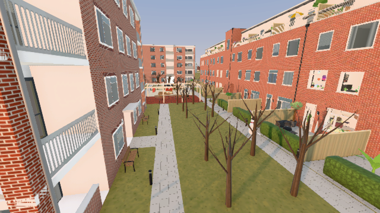
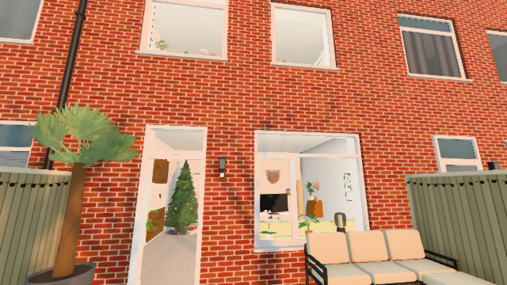

# Screen-wall source canvas — #2443

The existing normalized UV0 now samples the actual source colour canvas (including its cream rail/frame) and aligned roughness data. The authored MI keeps its path and uses the generated screen-wall master; geometry and other materials are unchanged. This covers L1007 and the shared Hus L patio/roof-terrace material. A/B/C have no separate screen-wall material in this scope.

Root viewed both full Native images and both source references: cream framing and standing boards are visible at courtyard and patio distances, without the former stipple. This accepts the frame/board requirement of #2443.

[Courtyard source reference](web-screenwall-courtyard.jpg) · [Patio source reference](web-screenwall-patio.jpg)

Verification: the actual source-canvas baker/repeat check passed; all-10 material coverage passed. The corrected normal two-entry ScreenWall build/check passed, followed by a separate normal Facade NullRHI build/check. One fresh rendered process then loaded L_Lunden once and captured these two views plus the #2421 night view: Native/runner/tool0,274.3s, no material/facade builders or saves (raster fallback warmup was in memory). All250 authored assets remained readonly/exact during capture,5231 Generated/12 Import/688 dependencies were exact, and runtime/actor state was restored. See [revision-bound readbacks and actual outcomes](result.json).

Limits: this is Linux CPU-Vulkan640×360 with raster fallback/AO0. It does not establish Windows, release, or full-scene lighting/season parity. The Native January image has snow0 while the source reference has snow; the source Christmas tree lamp also differs. Those are outside the material-pattern comparison. Source bump relief is still unported. Source reference JPEGs are valid images but their browser process returned1 at its final changelog-only guard; they are not reported as an all718-file passing run. Earlier UV-input and RHI-build failures remain recorded in result.json; the latter is #2504.

Original-only Unreal implementation: no public downstream transfer applies.
