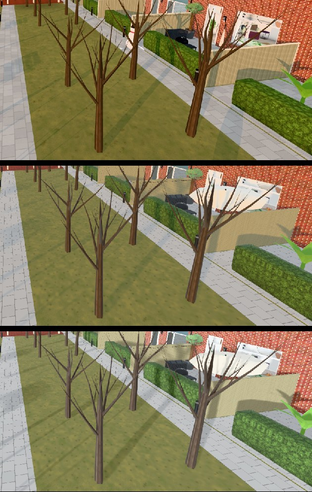
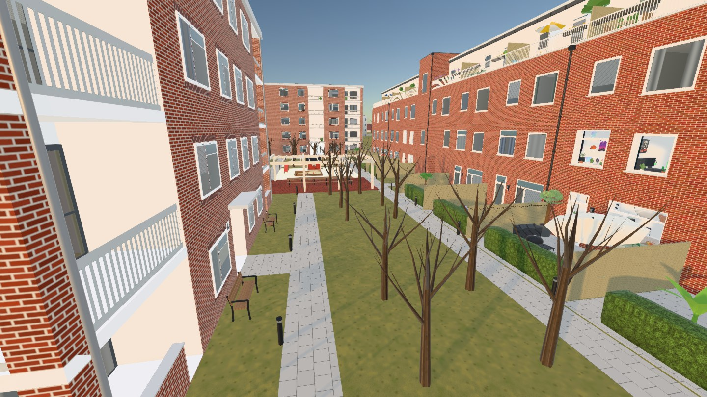
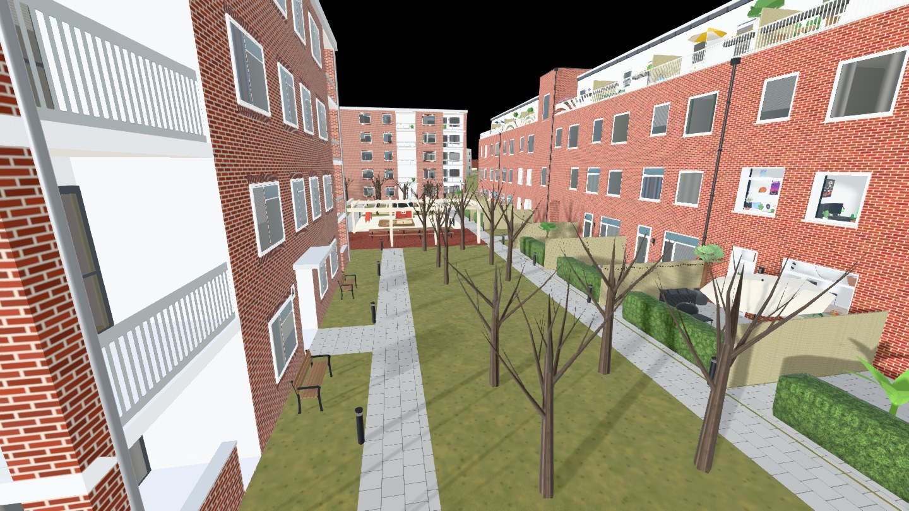

# Bare winter trees without shadows in Unreal (#2444): diagnosis

Unreal Editor 5.8.4 on Windows 11, 2026-11-22, headless (`-AllowCommandletRendering -RenderOffScreen`). Warm Windows
checkout `lunden-ue-wt/opus-2389` at `d8c98514` (assets last synced from the export of `33c6c991`; neither the
vegetation nor the lighting builder changed since). Camera: #2325's `courtyard` view, 15 January 2026 at 14:00, clear,
cascaded shadow maps as in `tests/capture_vegetation.py`. Each variant below changed the world in memory only (nothing
saved). Web picture: #2317's January courtyard (`?snow=0`).

**Result: the vegetation is not the cause.** The bare trunks and branches do cast shadows into the lawn and paving,
in the right places, but at about a third of the web's contrast, because the low winter sun lights the ground too
weakly next to the fill. The remedy is in the Lighting assets (`BP_LundenSky`, `build_lighting.py`), not in the
vegetation export, builder or materials.

## Shadow flags

- Export (`vegetation.glb` of `49f726d7`): all 812 trunk and 15 birch nodes carry no `castShadow: false` (they cast, as
  on the web, where `src/surroundings.js` sets `castShadow = true` on every `tree-trunks|birches|crowns` batch). Only the
  park shore growth is flagged off.
- Imported world (`L_Lunden`, `Level_vegetation_foliage`): every foliage component, the trunk and birch ones included,
  has Cast Shadow and Cast Dynamic Shadow on, no cull distance, and opaque bark materials; every `FT_Veg_*` foliage type
  has `cast_shadow` on. Setting the trunk components movable changed nothing.

## Light on the lawn

Mean display luminance (linear, from the sRGB pixels) of the sunlit lawn box `700,680,120,40`:

| Picture | Lawn | Sun's share (lit / without sun) |
|---|---|---|
| Web | 0.151 | about 1.55 (a trunk shadow line dips to 0.64 of the lit lawn beside it) |
| Unreal, as built | 0.178 | 1.17 (the sun turned off: 0.153) |
| Unreal, sun without atmosphere transmittance (`set_atmosphere_sun_light(False)`) | 0.208 | 1.37 |

- The sun stands 10.0° above the horizon. The web's sun keeps its full clear-day intensity above 7° (`src/daycycle.js`:
  `smooth(-0.02, 0.12, sunDir.y)`) and takes its colour from `SUN_LOW`/`SUN_HIGH`. Unreal's `BP_LundenSky` sun (20 lux)
  is an atmosphere sun light, so `SkyAtmosphere` transmittance at an air mass of about 5.6 removes more than half of
  it: the sun adds 0.025 to the lawn as built and 0.056 without the transmittance.
- The fill alone (sun off) already lights the lawn as brightly as the web's sunlit lawn (0.153 against 0.151); the
  web's shaded lawn is about 0.107. Even without the transmittance the shadow lines reach only 0.78 of the lit lawn.
- Shadow bias (0 or 2), 4096 cascades, PCSS, no light source angle and virtual shadow maps changed the lines' contrast
  by a few per cent at most.

The same mechanism explains the November finding in the issue (16 November 14:00, sun 10°). In June (sun about 57°)
the transmittance takes much less, which is why the crowns' shadows look right.

## Pictures

| Crops: web, Unreal as built, Unreal with the sun's atmosphere transmittance off |
|---|
|  |

| Unreal as built | Unreal, sun without atmosphere transmittance (diagnosis only) |
|---|---|
|  |  |

## What a fix needs

Both terms live in `build_lighting.py` / `BP_LundenSky` (Lighting assets, locked for #2394 at the time of writing):
compensate the sun's atmosphere transmittance so that its ground illuminance follows the web's elevation curve (its
colour is #2398), and check the clear-day fill on the lawn against the web's shaded lawn. Houses checked: not
applicable (the cause is the sun, not a house); the trees of the courtyard, Hus B's gravel (November) and the park
share the same foliage components.
