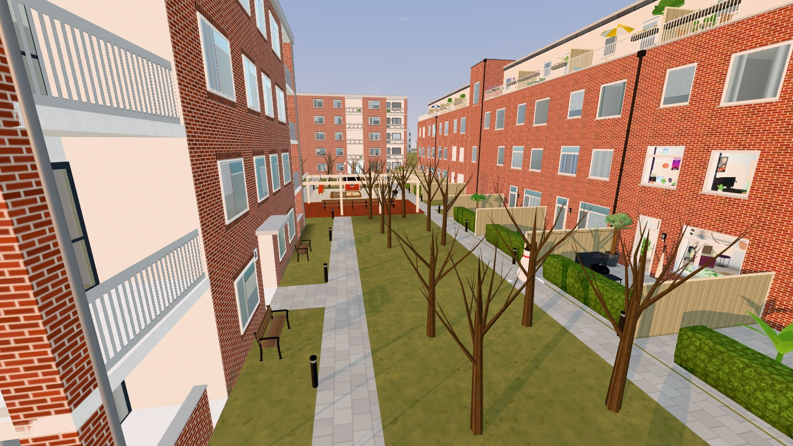
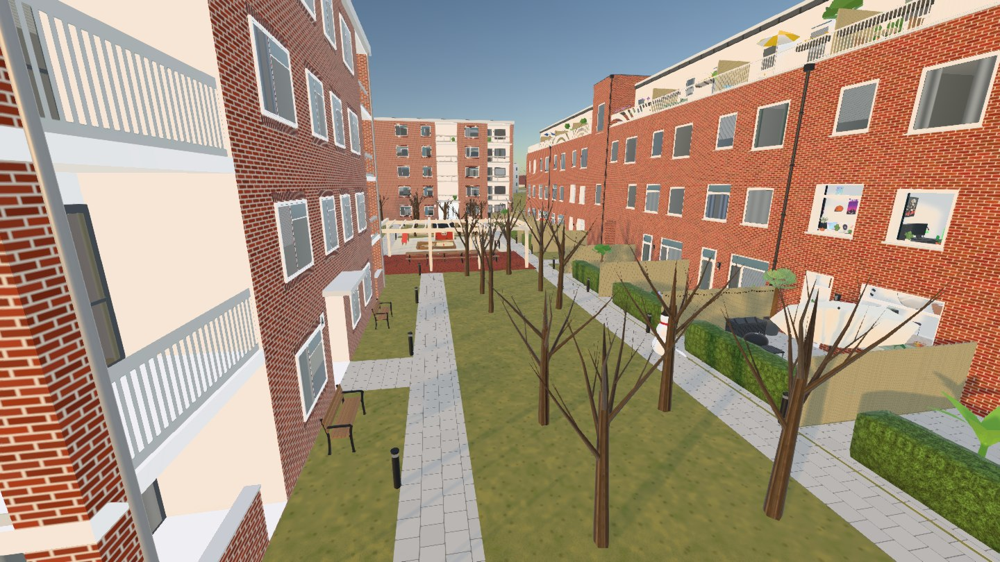
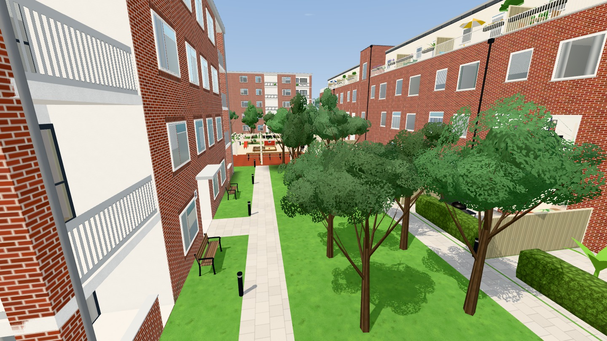
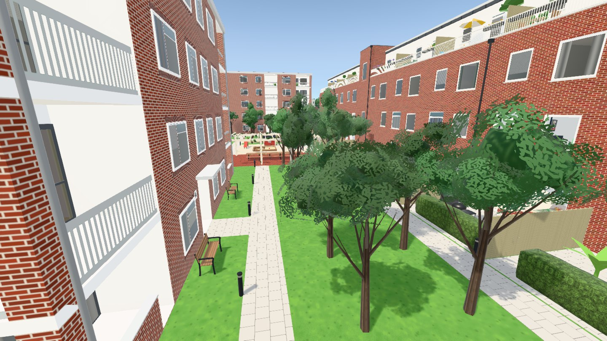
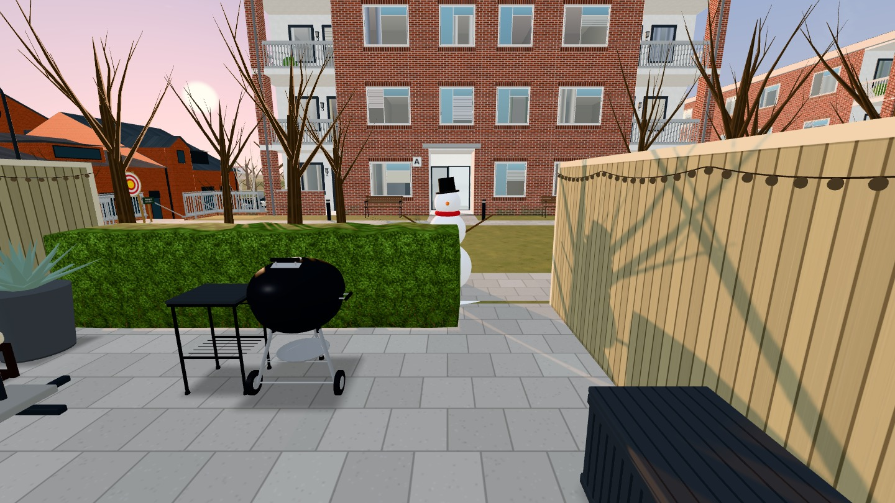
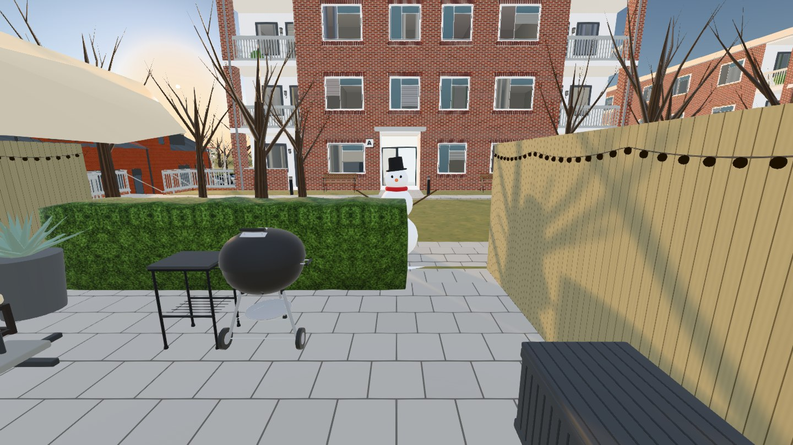
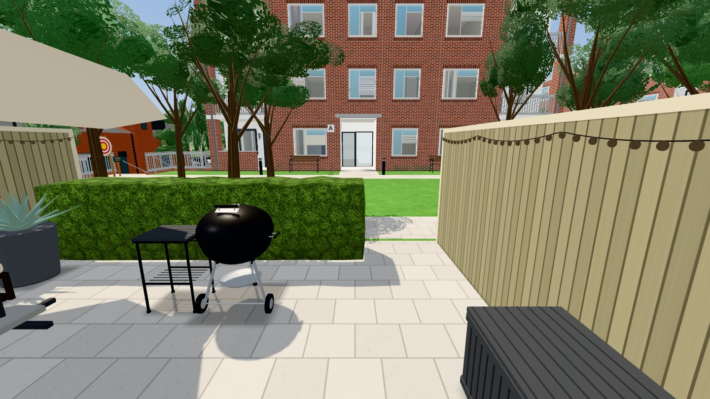
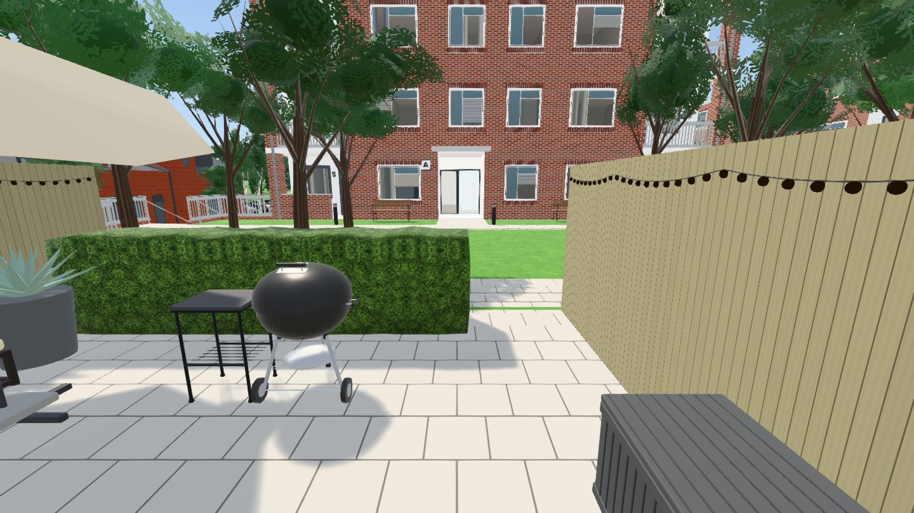

# The courtyard snowman in Unreal (#2445)

The web stands a snowman on the lawn just beyond the patio hedge's gap (`PATIO.snowman`, 1.4, 18.4, facing the house)
in `src/patio.js` `snowmanOut`'s months, December to February, whatever the weather (it also stands with `?snow=0`).
Unreal had none. The exporter now builds the web's own `Patio` and exports the snowman as a loose furniture node in
`l1007-uteplats` with the date window 1 Dec – 29 Feb (`season:snowman`, wrapping the new year), which
`BPC_LundenSeasons` already understood; how it works: [unreal.md, Seasons → Snowman](../../development/unreal.md#seasons-2295).

Commits: `a0e73607` (rule, export, tests, docs), `c9697ae9` (pictures). Unreal Editor 5.8.4 on Windows 11,
2026-11-22, warm worktree `lunden-ue-wt\opus-2389` at `a0e73607` with a full `sync-import.ps1 -ExportFrom` of a local
WSL export of the same sources. The web behaviour is unchanged (`snowmanOut` is the old expression).

## Checks

| Check | Result |
|---|---|
| `check-export.mjs --dir <export>` | pass: 11 files, 9,402 nodes, 315 sources |
| `season-rule.test.mjs --export <export>` | pass: the 17 date rows agree with `snowmanOut`; one snowman node `furn_snowman_l0_x140_z1840` (furniture, 14 parts) in `l1007-uteplats`, window 1201..229, no mismatch on 366 dates, 0.00 cm from `PATIO.snowman` |
| `sync-import.ps1` (full) | pass: `LUNDEN_SYNC_IMPORT_OK`, `LUNDEN_CHECK_OK`; the worktree stayed clean (no versioned asset changed) |
| `test_seasons` (PIE, `L_Lunden`) | pass: the snowman root and its 16 tagged part actors carry one window; BeginPlay on 22 Nov hid it; `ApplySeason` shows it with collision exactly on the true `snowman` rows (15 Jan, 1 Dec – 7 Jan, 28 Feb 2027, 29 Feb 2028) and hides it on the others (31 Mar – 30 Nov, 1 Mar 2027); tree, corner and cushions unchanged; 219 seasonal actors |
| `test_furnishing` (editor world) | pass: the snowman within 0.00004 cm of the web's spot in `Level_l1007-uteplats` and `L_Lunden`, with its season tags; 177 of 177 furnishing items |
| Courtyard and patio, 15 January 14:00 | pass: the snowman stands by the hedge gap, where the web stands it |
| Courtyard and patio, 21 June 14:00 | pass: no snowman, as on the web |

## Pictures

Unreal from `tests/capture_vegetation.py` at the game's exposure with the cameras in [views.json](views.json)
([January](unreal-capture-january.json), [June](unreal-capture-june.json)): #2325's `courtyard` camera and a new
`patio-snowman` view from the patio door south through the hedge gap. The web courtyard pair is #2317's (`?snow=0` in
January; the web did not change); the web patio pair is `capture-web-views.cjs` of the same view (`?snow=0` in
January).

| View | Web | Unreal |
|---|---|---|
| Courtyard, 15 January |  |  |
| Courtyard, 21 June |  |  |
| Patio, 15 January |  |  |
| Patio, 21 June |  |  |

## Not ported

- The web's snowman has no collision; in Unreal its actors get the collision every seasonal actor gets in season.

## Other visible differences in these pairs

- The parasol stays open in January in Unreal; the web folds it outside April – September: #2403.
- The patio hedge shows a repeating ring pattern close up ([crop](hedge-crop-january.jpg)): #2461 (new).
- The kettle grill is matt grey instead of glossy black: #2462 (new).
- The bare January trees cast no shadows on the lawn: #2444. Lawn and crowns lighter #2437; hedges cooler #2411;
  screen walls without the cream frame #2443; patio string lights at dusk #2409; brick #2427, #2428.
