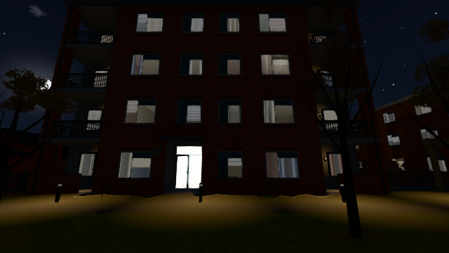
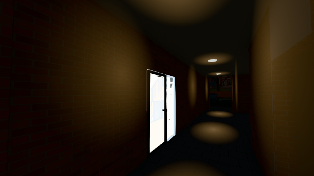
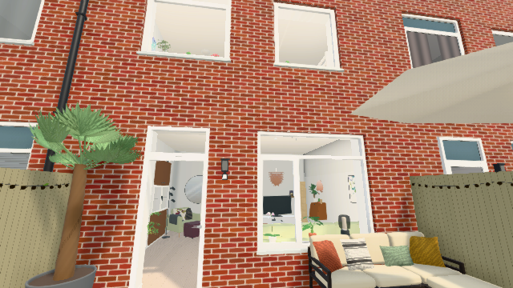

# Preserve source Basic materials (#2453, #2424 prerequisite)

The exporter previously required a base-colour texture before preserving a source
`MeshBasicMaterial`. Plain Basic colours became lit Standard materials. The normal
importer also only handled the mapped-label branch. This correction preserves all
source Basic materials and routes plain, vertex-coloured and mapped instances through
existing unlit graphs. It retains source colours, textures, alpha, vertex colours and
power shares. Intentional stairwell baked-light, garage and patio-bulb routes remain.

The tested source is `9b9abd58b4820334bdedb635889acad51f4ba15f`.
`publication-source-equivalence.json` verifies all five tested source files and the
323 export inputs remain byte-identical on publication. The full export source hash
is `7521f0221644f26469aa35f8fcd29c47efb1c1f5e58ec959000444cee04276ec`.

Actual verification:

- Production factory plus real Three r170 GLTFExporter round trip passed for plain,
  vertex-coloured and alpha Basic materials; Standard/Physical negative controls
  remain lit. The previous factory fails the Basic test.
- Production importer selection, map-loss rejection, garage exclusions and intentional
  stair-bake guards passed, alongside existing garage source checks.
- Full normal export completed in 105.354 seconds; normal export and material coverage
  checks passed. All ten zones retain geometry and transforms. There are 23 newly
  unlit metadata keys and 32 affected GLB material occurrences. The separately published
  #2494 car-trim map/key change is explicitly recorded in `export-comparison.json`.
- Actual normal all-ten-zone import and subsequent normal `--check` completed, then
  the final composed world was loaded and inspected: 278 imported slots, 566 loaded
  component slots and 113 effective material chains passed the Basic checks.
  All 113 chains are actually unlit; this includes material-instance overrides.
  The five reported lift keys appear in all four houses, A/B/C/L.
- Three original PNGs were saved and reviewed. The two dusk views use the original
  web camera, November 16 at 18:15, clear weather and the source dusk lamp rule.
  The patio uses the original #2388 June 21 at 14:00 fixture, all lamps off.
  All images are 640 × 360, vertical FOV 72, using Linux CPU Vulkan and normal exposure.
- Native and runner child results passed. The outer tool returned 143 after the
  completed child; its separate status is retained for the existing #2503 runner
  observability issue. No successful Windows GPU test is claimed.

The full readback, capture/restoration report, source/export checks and external
postflight are retained beside the images. All 250 authored assets remain physically
unchanged and read-only. Generated zone/material writes are the normal import output;
the captures save no material/lighting changes. No Lighting rebuild, global source
ambient activation, canonical 20-part run, cook or new shipping package was performed.

## Result images

These images establish the Basic material correction, not equal rendering across
engines. Whole-frame remaining differences are recorded in `target-coverage-2453.json`.
The existing unlit display gain and source colour factors were retained, without a
new colour/exposure fit. Global source-ambient acceptance in #2424 remains open and its
activation policy remains off. Glass #2388 also remains open: the original upper
window saturation still fails its original criterion in `patio-original-meter.json`.

This is original-only Unreal export/import work. It changes no web rendering and
does not apply to the public web downstream.

The remaining House A dusk window-room colours are registered as an additional
house variant on the open [#2455 investigation](https://github.com/solwation/lunden-3d-apartment/issues/2455#issuecomment-7238999725),
without claiming the same root cause as its original House C case. The specific
House L portico glass remains in [#2454](https://github.com/solwation/lunden-3d-apartment/issues/2454#issuecomment-7238999863).
The three byte-verified original images were embedded in the
[#2453 completion comment](https://github.com/solwation/lunden-3d-apartment/issues/2453#issuecomment-7239000011)
before the resolving commit. Full #2424 remains open.
