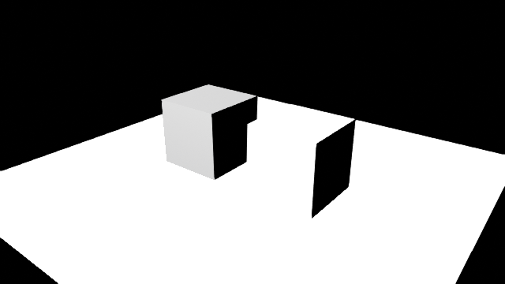

# Local Linux Unreal development (#2467)

Environment: Ubuntu 24.04.5 under WSL2, Intel UHD 630, Epic's precompiled
Unreal 5.8.4. This is an opt-in development environment; Windows release and
full-quality visual acceptance remain separate.

The reduced runtime is installed on D: (about 31 GiB, 82,757 selected files).
The exact engine version, six core-file archive CRCs and shared-library
dependencies were checked. Engine source, SDK Extras, templates, intermediate
files, debug symbols and LinuxArm64 were omitted; the original archive is kept.
Source and real Git LFS assets are in an ext4 checkout. Runs/cache use D: to avoid
filling the Windows disk backing WSL.

## Checks

- Runner failure handling: seven unit tests cover a wrong engine, swallowed Python
  failures, missing logs, failed exits, timeouts and empty/incomplete Automation
  reports; configuration retains the project defaults without editing them. The
  process test also proves a SIGTERM-resistant worker is killed after its editor exits.
- Actual Unreal NullRHI profile probe: **pass**, 161.15 seconds, source
  `14261011173f5b65bbb64e5d66c42fcec3ecfca7`. All seven expected quality CVars
  were read as zero inside Unreal Python. This proves loading/configuration,
  not rendering.
- Actual Unreal asset smoke: **pass**, 120.53 seconds, source `a344311f`.
  Created, saved, read and deleted a scratch material; read the committed
  2,067-byte LFS fixture material.
- Actual Unreal Automation: **one pass**, zero failures/unrun tests, source
  `cf444cde`; the engine exited with code zero. The first wrapper rejected the
  report's UTF-8 BOM. Its reader was fixed and checked against that same report
  without repeating the successful engine test; [counts and report hash](automation-review.json).
  The same engine log confirms writable file cache and Zen data paths on D:.
- GPU prerequisites: buffer fill, render-target clear and a shader-based triangle
  passed on Intel UHD 630 via private Mesa Dozen 26.1.8. Logs:
  [buffer/clear](vulkan-probe.txt), [triangle/pixels](vulkan-triangle-probe.txt).
- Actual Unreal with Dozen: **failed** despite passing the SM5 profile. The early
  timestamp query-pool reset reaches `CopyBufferRegion` in the Intel D3D12
  driver and crashes. No supported workaround was verified; separate triangle
  success must not be presented as Unreal compatibility.
- First system llvmpipe attempt: **failed** because Unreal excludes CPU devices
  unless explicitly allowed. The retry uses its real `-AllowCPUDevices` option;
  no advertised feature/API version is overridden.
- First explicit CPU capture: **incomplete**, 600-second timeout (611.02 seconds
  with cleanup), `timedOut:true`, `passed:false`. Vulkan SM5 initialized and
  shaders compiled, but no PNG was produced. Preserved the warm cache and
  reassessed the initial-compile cost before the longer retry.
- Completed CPU Vulkan capture: **pass**, 1,131.37 seconds including initial
  shader/material compilation, source `a5fcc597`. Its very dark test material
  made the image difficult to review, so only the fixture view was recaptured.
- Reviewed CPU Vulkan capture: **pass**, 107.52 seconds, source `9ba06ed7`.
  Real llvmpipe SM5, all seven low-profile CVars checked inside the rendered
  process, 640×360 PNG, clean editor exit and worker cleanup.
  [Source/configuration/device/image hash](render-check.json).
  This used an existing cache and a changed test scene; it is no performance benchmark.

## Result image

Temporary two-cube fixture: dark committed project material on the right, a
bright built-in control on the left. Bright test lighting, a bright floor,
black background and disabled shadows are intentional. This verifies local
loading/rendering. Generated-world and Windows material/lighting acceptance,
interactive frame rate, cooking and packaging remain separate.

Scoped engine results: [engine-checks.txt](engine-checks.txt). Full raw logs and
installation/driver provenance remain private in the local runtime directories.
The repository-wide link checker still reports the pre-existing release-note
template placeholder `{{setupUrl}}`; the affected relative documentation
links pass. No web/export source, Windows default or public downstream behavior
is changed, and this Unreal-only tooling has no public port.
