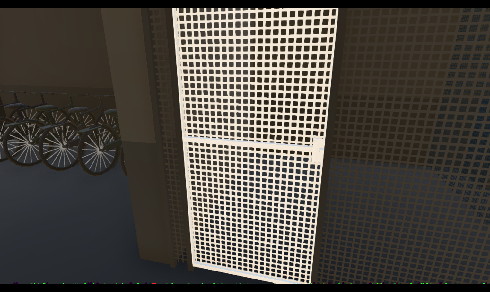

# Färgbrus vid editorvyns nederkant

Oförändrad originalbild från #2328:s första CPU-Vulkanbildprov på
`19f6083016a36defd7973bca84296fed7b84bac6`, Unreal Engine 5.8.4, llvmpipe LLVM 20.1.2, linux-low.
PNG: 1526 × 910, kamerans 16:9-bildyta har svart letterbox ovanför/under. En tunn rad
färgade pixlar syns precis ovanför den undre svarta kanten. Bildprovet hann spara 10 bilder
före PythonAutomationTest-pluginens interna 300 s-gräns; detta är inget godkänt komplett bildprov.

Ursprungets SHA-256 och misslyckade provets villkor finns i
[första bildförsökets kördata](../2328/linux-verification.json).
Upplösningen utreds separat i [#2469](https://github.com/solwation/lunden-3d-apartment/issues/2469).
